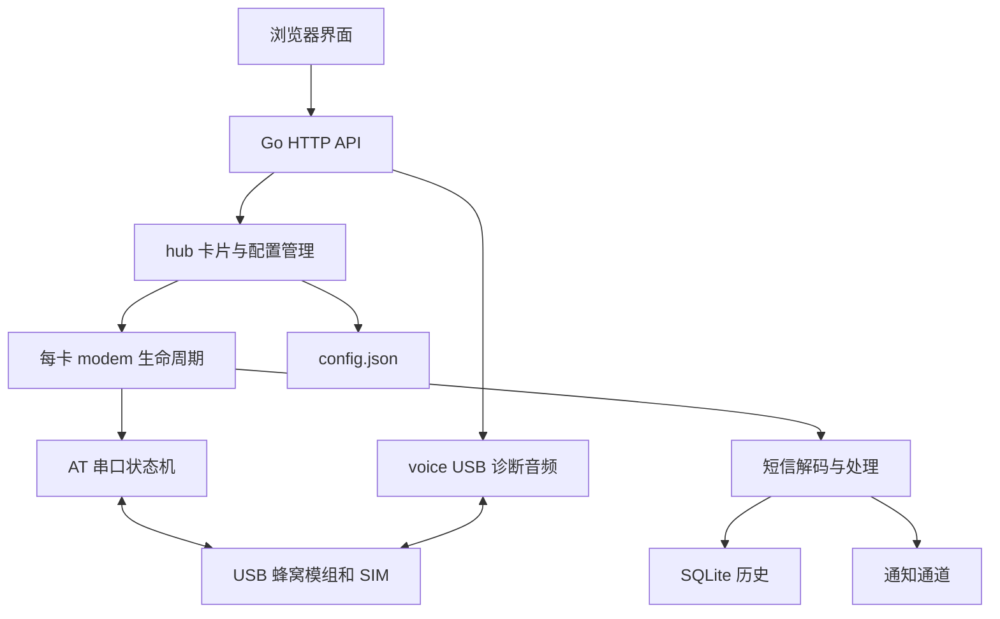

# smspub 项目说明

smspub 将多个 USB 蜂窝模组接入一个 Web 管理界面。每个模组对应一张卡片，独立维护串口连接、在线状态和短信收发；短信历史写入本地 SQLite，通知通过宿主机网络发送到已配置的通道。

## 能力和边界

| 功能 | 当前实现 | 使用条件 |
|---|---|---|
| 接收与发送短信 | AT + PDU，GSM7/UCS2，长短信分段及拼接 | 模组、SIM、运营商短信业务可用 |
| 多卡管理 | 自动探测、IMEI 跟随重绑、掉线重连、可选 USB 复位 | Linux 串口与 sysfs 可见，权限正确 |
| 历史消息 | SQLite 持久化；前端筛选、搜索、排序与批量删除 | 运行目录中的 `data/` 可写 |
| 通知 | 11 类通道，独立启用，异步发送与有限重试 | 宿主机能访问通知服务，密钥有效 |
| 管理员短信 | `SMS:号码:内容` 转发；`RESET` 重启进程 | 显式配置该卡管理员号码 |
| 电话控制 | 拨打、接听、挂断、来电状态 | AT 通话指令和运营商语音服务可用 |
| 浏览器收听 | ML307A USB 诊断音频通过同源 HTTP 流播放 | 已支持的 USB 设备/接口，诊断口可用 |
| 浏览器麦克风 | 实验性实时上行，自动重连、静音 | `ML307A-DSLN-MTSH1S00` 固件校验通过、安全上下文、麦克风权限 |

`online=true` 表示程序中的模组在线状态，不等于已实测短信投递或语音接通。`voice.supported=true` 只代表通话查询受支持，不能证明 VoLTE 注册成功。音频能力接口报告支持后，仍需真实通话验收听感和稳定性。

服务没有内置账户、密码、API Token 或角色权限。配置读取接口会返回通知凭据，短信、拨号、删除和重启接口可直接操作设备；部署时必须先确定可信访问范围。完整要求见[部署指南](DEPLOYMENT.md)。

## 技术结构

- Go 单服务，`net/http` 提供 API 和静态文件；当前 `go.mod` 要求 Go **1.27.1** 或兼容的更高版本。
- 前端是原生 HTML/CSS/JavaScript，通过根目录 `embed.go` 编译进二进制，不需要 npm 构建。
- 串口使用 `go.bug.st/serial`，Linux 设备操作使用 `golang.org/x/sys`。
- 数据库使用纯 Go 的 `modernc.org/sqlite`，构建可以设置 `CGO_ENABLED=0`。
- 没有 Redis、消息队列、独立数据库服务器或后台 worker 部署要求。



## 目录和职责

| 路径 | 职责 |
|---|---|
| `cmd/smspub/` | 启动、参数、HTTP/HTTPS、信号退出 |
| `internal/model/` | JSON 字段与共享结构，调优默认值 |
| `internal/config/` | 配置校验、深拷贝、原子保存 |
| `internal/hub/` | 组装模块，卡片热更新，自动探测，来电和设备消失提醒 |
| `internal/at/` | 串口、命令队列、URC、设备扫描和目录监听 |
| `internal/modem/` | 模组初始化、心跳、重连、收发、Ping、电话控制、USB 复位 |
| `internal/pdu/` | PDU 编解码、GSM7 |
| `internal/sms/` | 长短信拼接、黑名单、管理员指令、入站处理 |
| `internal/push/` | 11 类通知通道及重试 |
| `internal/store/` | SQLite 表、查询、删除及旧 JSONL 迁移 |
| `internal/voice/` | Linux 诊断接口识别、PCM 提取、受固件约束的麦克风上行 |
| `internal/web/` | REST API、静态文件、安全响应头、同源检查、音频流 |
| `internal/logger/` | 内存环形日志和输出 |
| `web/` | 首页、历史消息、演示页、浏览器音频与 AudioWorklet |
| `tools/` | 模拟模组、诊断/IMS 实验、音频工具及相关测试 |
| `.github/workflows/docker.yml` | main 推送/手动触发的镜像构建流程 |

## 主要数据流

**收到短信**：模组 URC → AT 层 → PDU 解码 → 长短信拼接 → 黑名单/管理员处理 → 历史记录与通知。黑名单命中后不保存、不推送。`store_sms=true` 优先使用模组存储通知模式，重连时可补读存储中的短信；默认直投模式可能丢失程序离线期间的消息。

**发送短信**：Web 或管理员指令 → hub → modem 分段发送 → 成功后追加出站历史。如果模组发送成功但数据库写入失败，API 会返回错误；这种情况不能直接自动重发，以免重复发送。

**配置更新**：`POST /api/config` 提交完整对象 → 校验 → 同目录临时文件写入、同步、重命名 → 比较卡片差异 → 启停/重启相关卡片和替换推送通道。HTTP 监听地址需要进程重启。

**音频**：浏览器通过 HTTP 获取 NDJSON 音频流；麦克风通过带会话令牌的 JSON 分块上传，共用同模组诊断连接。当前实现不是 WebRTC，也不需要部署 TURN/STUN、SIP 或 Python 音频服务。主机 IMS 研究是另一条实验路线。

## 数据和运行状态

| 内容 | 保存位置 | 特性 |
|---|---|---|
| 配置与通知凭据 | `-c` 指定的 JSON 文件 | 首次不存在时生成，程序写入权限为 0600 |
| 短信历史 | **进程工作目录**的 `data/smspub.db` | `-c` 改路径不会改变数据库目录 |
| 旧短信文件 | `data/sms-*.jsonl` / `.imported` | 启动时按导入规则迁移，保留原文件备查 |
| 最近运行日志 | 内存环形缓冲，主程序容量 1024 条 | 重启后内存日志消失；长期保存用容器日志或 journal |
| TLS 证书与私钥 | 部署者指定的文件 | 不自动申请、续期或生成 |

`messages` 表包含 `id`、`card_id`、`dir`、`sender`、`recipient`、`ts`、`text`，`ts` 是 Unix 毫秒。历史查询一次返回全部记录，分页和筛选在浏览器进行；记录较多时应关注查询与页面内存开销。

## 本地开发和检查

从仓库根目录以普通用户执行；Go 版本先与 `go.mod` 核对。root 会绕过只读目录限制，使 `TestAtomicWrite` 的权限断言失败。

```bash
go test ./...
go vet ./...
CGO_ENABLED=0 go build -trimpath -o /tmp/smspub-dev ./cmd/smspub
node --test tools/test_callaudio.cjs
python3 -m unittest discover -s tools -p 'test_*.py'
```

Node.js 仅用于前端音频测试，Python 仅用于辅助工具；两者都不是 Go 生产服务运行依赖。Python 工具的真实设备命令可能有额外依赖，按对应工具说明安装。需要竞态检查时使用支持 race 的 Go 工具链和 C 编译器运行 `go test -race ./...`；不要在 `CGO_ENABLED=0` 下运行 race。

前端开发可用 `-dev` 从当前目录 `web/` 读取文件。API 仍由 Go 服务提供，生产部署使用嵌入资源。无后端展示可打开 `web/demo.html`、`web/demo-history.html`，其中演示数据不证明后端或硬件可用。

自动检测会扫描可见的 USB 串口；本地无硬件测试应使用独立运行目录、`auto_cards=false`、空 `channels`，避免触碰现有设备与通知通道。完整模拟示例见[部署指南](DEPLOYMENT.md#无硬件验证)。
